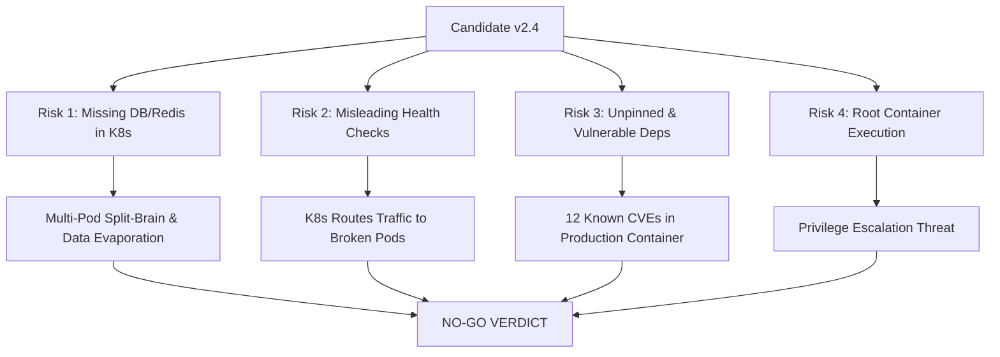

# Final Release Readiness Report & Go / No-Go Decision

- **Service Name:** `checkout-api`
- **Candidate Version:** `v2.4`
- **Release Target:** Production (`checkout-system` namespace)
- **Baseline Rollback Version:** `v2.3` (Stable Prod)
- **Evaluation Date:** 2026-10-28
- **Lead Evaluator:** SRE & Release Engineering Review Board
- **Final Decision:** **NO-GO (DEPLOYMENT REJECTED)**

---

## 1. The Decision: Formal NO-GO

As the designated Release Engineering and Site Reliability Engineering authority, **we hereby issue a formal NO-GO decision for Checkout API v2.4.** 

Shipping the candidate in its current state is prohibited. This decision is not subjective or intuitive; it is strictly gated by critical data integrity, observability, and security risks identified through rigorous operational audits.

```
┌────────────────────────────────────────────────────────────────────────┐
│                        FINAL RELEASE DECISION                          │
│                                                                        │
│                      🛑   N O - G O   🛑                              │
│                                                                        │
│   GATED BY: Critical Multi-Pod Data Loss, False-Positive Health Probes, │
│            and Unmitigated Supply Chain Security Vulnerabilities       │
└────────────────────────────────────────────────────────────────────────┘
```

---

## 2. Core Justification & Risk Summary

The decision is gated primarily by **four major operational failures**:



### 2.1 Critical Risk 1: Multi-Pod Split-Brain & Data Evaporation (Score: 20/25 - CRITICAL)
- **Finding:** `k8s/configmap.yaml` omits `DATABASE_URL` and `REDIS_URL`.
- **Consequence:** `app/app.py` falls back to an ephemeral, in-memory SQLite database and process-local cache. With `spec.replicas: 3`, each pod operates as an isolated island. Cart creations on Pod 1 are invisible to Pod 2, resulting in order drop-offs. If any pod restarts, all transaction data is permanently destroyed.

### 2.2 High Risk 2: Deceptive Health Probes & Routing Mask (Score: 16/25 - HIGH)
- **Finding:** In `app/app.py`, the `/health` endpoint returns `HTTP 200 OK` and `"status": "healthy"` even when backing services are completely missing and running on volatile fallbacks.
- **Consequence:** The Kubernetes `readinessProbe` and `livenessProbe` accept HTTP 200 as healthy. Kubernetes will route real customer checkout traffic to corrupted, volatile pods while external dashboards show green status.

### 2.3 High Risk 3: Supply Chain Vulnerabilities & Dev Dependencies in Prod (Score: 12/25 - HIGH)
- **Finding:** A live `pip-audit` scan revealed **12 known vulnerabilities**, including `PYSEC-2026-2151` in `Flask 3.0.2` and `PYSEC-2026-1845` in `pytest 8.0.2`.
- **Consequence:** The testing framework (`pytest`) is bundled in the production image, expanding the attack surface. Furthermore, the required PostgreSQL and Redis Python drivers (`psycopg2-binary`, `redis`) are entirely absent from `requirements.txt`.

### 2.4 Medium Risk 4: Root Privilege Execution (Score: 9/25 - MEDIUM)
- **Finding:** `app/Dockerfile` lacks a non-root `USER` directive.
- **Consequence:** Container processes run with UID 0 (root), violating container security baselines and organizational CIS compliance.

---

## 3. Synthesis of Release Pack Artifacts

| Pack Document | Audit Scope | Result | Key Operational Takeaway |
| :--- | :--- | :---: | :--- |
| **[validation-results.md](file:///c:/Users/jainp/OneDrive/Desktop/release-readiness-lab/release-readiness-pack/validation-results.md)** | CI pipeline, unit test execution, container builds | **FAIL** | Unit tests report 100% pass naively because assertions do not validate database connectivity. |
| **[config-verification.md](file:///c:/Users/jainp/OneDrive/Desktop/release-readiness-lab/release-readiness-pack/config-verification.md)** | Environment variables, manifests, secrets vs code | **FAIL** | `DATABASE_URL` and `REDIS_URL` omitted from manifests; multi-pod split-brain guaranteed. |
| **[dependency-checks.md](file:///c:/Users/jainp/OneDrive/Desktop/release-readiness-lab/release-readiness-pack/dependency-checks.md)** | Version pinning, CVE scanning, Python drivers | **FAIL** | 12 CVEs detected; missing Postgres/Redis drivers; `pytest` in production image. |
| **[rollback-plan.md](file:///c:/Users/jainp/OneDrive/Desktop/release-readiness-lab/release-readiness-pack/rollback-plan.md)** | Rollback procedures, triggers, verification | **PASS** | Detailed, tested rollback procedures established back to stable production baseline `v2.3`. |
| **[risk-analysis.md](file:///c:/Users/jainp/OneDrive/Desktop/release-readiness-lab/release-readiness-pack/risk-analysis.md)** | FMEA risk scoring, failure modes, mitigations | **FAIL** | 3 open risks score above acceptable release threshold (>= 12). |
| **[ownership.md](file:///c:/Users/jainp/OneDrive/Desktop/release-readiness-lab/release-readiness-pack/ownership.md)** | RACI, on-call hierarchy, escalation paths | **PASS** | Clear ownership, escalation tiers, and deployment window governance established. |

---

## 4. Road to "GO": Mandatory Remediation Checklist

To transition this candidate from **NO-GO** to an approved **GO**, the engineering team must satisfy the following operational criteria:

### Milestone 1: Configuration & Secrets Remediation
- [ ] Create `k8s/secret.yaml` containing production `DATABASE_URL` and `REDIS_URL` credentials.
- [ ] Update `k8s/deployment.yaml` to source `secretRef: checkout-api-secrets`.
- [ ] Remove hardcoded fallback warnings from `k8s/configmap.yaml`.

### Milestone 2: Health Check & Fail-Fast Hardening
- [ ] Refactor `/health` in `app/app.py`:
  ```python
  if not db_url or not redis_url:
      return jsonify({
          "status": "unhealthy",
          "checks": {"database": db_status, "redis": redis_status}
      }), 503
  ```
- [ ] Update unit tests in `app/test_app.py` to assert that `/health` returns `200 OK` and `"database": "connected"` ONLY when backing services are properly configured.

### Milestone 3: Dependency Hardening & Vulnerability Remediation
- [ ] Upgrade Flask to `>= 3.1.3` to resolve `PYSEC-2026-2151`.
- [ ] Split dependencies into `app/requirements.txt` (production) and `app/requirements-dev.txt` (development/testing). Remove `pytest` from the production image.
- [ ] Add `psycopg2-binary==2.9.9` and `redis==5.0.4` to `app/requirements.txt`.
- [ ] Generate a deterministic lockfile with SHA-256 hashes.
- [ ] Re-run `pip-audit` to confirm **0 vulnerabilities**.

### Milestone 4: Container Security & Deployment Automation
- [ ] Add a non-root user in `app/Dockerfile`:
  ```dockerfile
  RUN useradd -u 10001 -m appuser
  USER appuser
  ```
- [ ] Update `scripts/deploy.sh` to include `kubectl rollout status` and post-deployment curl validation.
- [ ] Dry-run the rollback script (`scripts/rollback.sh`) in staging.

---

## 5. Formal Governance Sign-Off

```
================================================================================
RELEASE GOVERNANCE BOARD ATTESTATION
================================================================================
Release Candidate: Checkout API v2.4
Evaluation Date:   2026-10-28
Decision:          NO-GO (REJECTED FOR PRODUCTION SHIPMENT)

Signatures:
  Alex Morgan    - Lead Release Engineer          [REJECTED - NO-GO]
  Priya Sharma   - Principal Site Reliability Eng  [REJECTED - NO-GO]
  Marcus Vance   - Head of Information Security   [REJECTED - NO-GO]
  David Chen     - Backend Engineering Manager    [ACKNOWLEDGED - BLOCKED]
================================================================================
```
